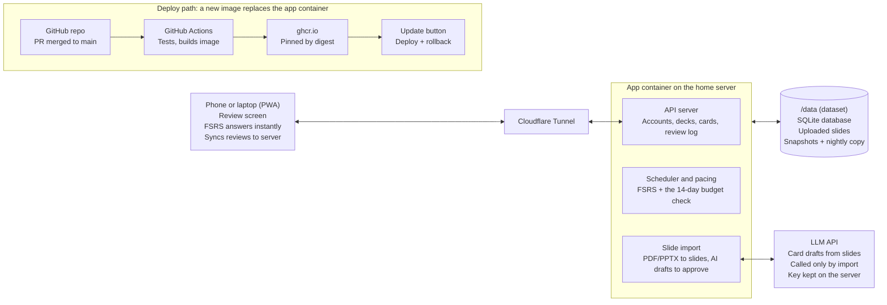

# AW-Study: Design

Nov 17, 2026 · Nathan, with Claude. Exported from the shared design doc; edit here once we start building, and keep it current.

## Summary

AW-Study is a spaced-repetition app for lecture content: you give it a daily time budget (say 60 minutes), it shows you new material and reviews at the right intervals, and it never lets the review pile grow past that budget. Cards come from lecture slides (AI drafts, you approve) or are written by hand. Reviewing should feel rewarding, the way a game does, without rewarding fake progress.

Goals for the first version:

- Reviews scheduled by FSRS, the open algorithm Anki now uses, not a home-made one.
- A daily time budget that sets how many new cards you get.
- Cards from slides: upload a PDF or PPTX, approve the drafts.
- Works well on a phone, installable, and quick to open for a few minutes.

Code: [github.com/EassunKim/AW-Study](https://github.com/EassunKim/AW-Study) (Matt's repo; Nathan is a collaborator).

## Who it's for and scope

The first version is for Matt and Nathan, built so classmates can join later without a rewrite. That means real accounts and per-user data from day one, but no sharing, social features or billing yet.

| In the first version | Later |
| --- | --- |
| Accounts, decks, cards (Q/A and fill-in-the-blank) | Shared decks between users |
| FSRS reviews with a daily time budget | FSRS tuned to each user from their review log |
| Slide upload with AI drafts to approve | Images and diagrams as card content |
| Streak, daily ring, simple stats | Leaderboards, friends, achievements |
| Installable web app (PWA) | Offline reviews that sync later; Anki `.apkg` import |

Who can sign up, and how AI costs are capped per user, are open questions below.

## The daily loop and scheduling

You set a time budget, not a card count; the app fills it with due reviews first, then as many new cards as the next two weeks can absorb. This fixes Anki's classic problem: a fixed "20 new a day" that turns into a wall of reviews two weeks later.

**Scheduler: FSRS.** Each card keeps a stability, a difficulty and a due date; each answer (Again / Hard / Good / Easy) updates them. Use the maintained MIT library (`ts-fsrs` for JS/TS; ports exist for Python and Rust) with a target retention of 90%. Every review is logged (card, grade, time taken, timestamp) so FSRS can later fit its parameters to each person.

**Daily session:**

1. Due reviews, oldest-overdue first. If they alone exceed the budget, show the most overdue and carry the rest (FSRS handles late reviews).
2. New cards, in the order of the lecture they came from, until the budget is used.
3. Cards failed today come back a few minutes later in the same session (learning steps).

**Pacing new cards:** measure each user's average seconds per review and per new card. Using FSRS's predicted due dates, estimate the review minutes for each of the next 14 days. Add a new card only if no day in that window goes over the budget. Until there's history, assume 10 s per review and 30 s per new card.

**The day** ends at a set hour (default 4 a.m., local time), so late-night study counts for the night it was done.

**Exams:** later, a deck can have an exam date; cards then get scheduled to be reviewed at least once in the days before it, even if FSRS says they could wait.

## Making cards

AI writes drafts; nothing joins a deck until the user approves it. Bad AI cards are the main way apps like this fail, and approving them is itself a first pass over the material.

**By hand:** a quick editor for question/answer and fill-in-the-blank (`{{c1::word}}` style), with simple formatting and maths (KaTeX).

**From slides:**

1. Upload a PDF or PPTX. PPTX is converted to PDF on the server so both take the same path.
2. Split into one record per slide: its text, its speaker notes, and a rendered image of the page.
3. Send slides in batches to an LLM with a fixed prompt: make 0-3 atomic cards per slide, one fact each, skip title and agenda slides, quote the slide's own terms. Slides that are mostly a diagram are sent as the image.
4. Show the drafts beside their slide: keep, edit, or discard each, or keep all from a slide.
5. Kept cards remember their lecture and slide number, so during review you can tap through to the original slide.

**Cost and limits:** which model and who pays is open. Whatever is chosen, cap each user's slide pages per day, keep the API key on the server only, and store the drafts so a re-open never pays twice.

## Motivation

Reward finishing the day's work and remembering honestly, never pressing buttons. If grading yourself "Easy" earns more points, people inflate their grades and FSRS schedules them wrong, which hurts their exam.

| Mechanic | What earns it | Guardrail |
| --- | --- | --- |
| Daily ring | Fills as the day's budget is worked through; a burst when it closes | Fills by time spent on due cards, not cards skipped |
| Streak | Every day the ring closes | One freeze day a week, earned, so one bad day doesn't erase a month |
| Combo | Consecutive correct answers in a session; sound and a small animation | Same reward for Hard and Good; Easy earns nothing extra |
| XP and levels | Reviews done and new cards learned | No XP for reviewing cards that aren't due |
| Stats | Cards mastered per lecture, predicted retention, a calendar heatmap | Shows true retention, even when it drops |
| Reminder | A push notification when today's session is ready, at a time the user picks | Off by default; at most one a day |

Feel matters as much as the rules: answers should respond instantly (no waiting on the network), with sound that can be turned off.

## Platform and architecture

One web app in one container, installable on phones as a PWA, with SQLite for storage; the stack itself is still open (see Open questions).

The browser runs FSRS itself so every answer responds instantly, then syncs the review log to the server, which stays the source of truth.

**Main data:**

| Table | Holds |
| --- | --- |
| users | Account, time budget, day-start hour, time zone |
| decks | Name, owner, optional exam date |
| lectures | Uploaded file, title, slide count, link to deck |
| slides | Lecture, page number, text, notes, rendered image |
| cards | Deck, type, front/back, source slide, FSRS state, due date |
| drafts | AI-made cards waiting for approval, per slide |
| reviews | Card, grade, seconds taken, time; never edited, only added |

The `reviews` table is the most valuable data: stats, streaks and per-user FSRS tuning are all computed from it.

## Hosting and deploys

AW-Study runs on Nathan's home server as an image app, deployed exactly like Yagoodle: push to `main`, wait for the green tick, press **Update from GitHub** at apps.pacificfish.ca.

- **Image:** GitHub Actions builds one Docker image and publishes it to ghcr.io on every push to `main`. The deploy pins it by digest, health-checks it and rolls back on failure, so the app needs a `/healthz` route.
- **Address:** a subdomain such as study.pacificfish.ca, through the existing Cloudflare Tunnel.
- **Compose rules:** the published port must be on 127.0.0.1, the compose needs the standard security settings, and memory is 128 MB to 2 GB. PPTX conversion (LibreOffice) is the heavy part; it may need 1 GB or a separate small worker.
- **Data:** the database and uploaded slides live in a dataset mounted at `/data`. It is snapshotted daily and copied nightly to the mirrored pool.
- **Secrets:** the LLM API key and session secret go in a server-side `.env`, never in the repo (the repo is public).

Nathan sets up the server side (app entry, dataset, subdomain) once the first image exists.

## Working together

Matt and Nathan each work with Claude Code on their own PC, so the repo itself must hold the rules both Claudes follow.

- **`CLAUDE.md` in the repo:** the stack, how to run and test, the rules below, and decisions made. Personal notes stay in each person's own Claude memory, not the repo.
- **Branches and PRs only:** nobody pushes to `main`. CI runs every test on each PR; the other person reviews and merges. `main` deploys only when someone presses Update.
- **Owners by area** to avoid colliding PRs (to be agreed): for example Matt on slide import and AI, Nathan on scheduling, review screen and hosting.
- **Small PRs, merged often.** A PR open for days drifts from `main` and conflicts.
- **Tests are the contract:** the scheduler and pacing get unit tests with fixed dates; the review screen gets browser tests on phone and desktop sizes. A new rule is proved by a test that fails without it.
- **Nothing secret in git:** `.env`, keys, databases and uploads are in `.gitignore` from the first commit.

## Milestones

Each milestone is usable on its own and deployed before the next starts. No dates yet: set them once the stack is chosen.

1. **Skeleton:** repo, `CLAUDE.md`, CI that tests and publishes the image, `/healthz`, deployed at the subdomain with sign-in.
2. **Study by hand:** decks, hand-made cards, FSRS reviews, review log. Usable daily from here.
3. **Time budget:** per-user timing, new-card pacing over 14 days, the daily ring and streak.
4. **Slides to cards:** PDF upload, AI drafts, approve screen, tap-through to the slide. Then PPTX.
5. **Polish the reward loop:** combos, sounds, XP, stats, the daily reminder, installable PWA.
6. **Later:** offline reviews, Anki import, FSRS fitted per user, exam dates, classmates and shared decks.

## Open questions

Tick each once Matt and Nathan agree, and write the answer under it (then copy it into `CLAUDE.md`).

- [ ] **Stack:** TypeScript end to end (one language, `ts-fsrs` in browser and server) or what Yagoodle uses? Which framework, if any?
- [ ] **Who can sign up:** just us two (Cloudflare Access with Google, nothing to build), or classmates too (our own accounts)?
- [ ] **AI provider and budget:** which model reads the slides, and who pays? A monthly cap per user?
- [ ] **Area owners:** who takes which part of the milestones?
- [ ] **Subdomain name:** study.pacificfish.ca, or something else?
- [ ] **Card types beyond Q/A and fill-in-the-blank:** image occlusion (hide part of a diagram)? Worth it in the first version?
- [ ] **App name:** keep AW-Study?
