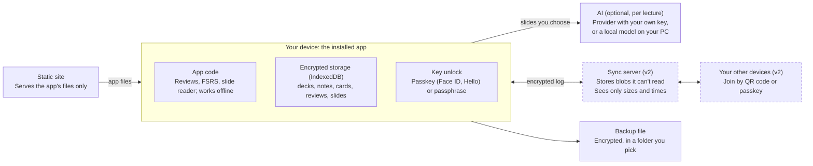

# AW-Study: Design

Nov 17, 2026 · Nathan, with Claude. Exported from the shared design doc; edit here once we start building, and keep it current.

## Summary

Honed (working name; the repo is AW-Study) is a spaced-repetition app for lecture content that keeps each user's data on their own devices. You give it a daily time budget (say 60 minutes); it shows you new material and reviews at the right intervals, and never lets the review pile grow past that budget. Lecture slides often aren't meant to be shared, so slides and cards are stored encrypted on the device, and anything that syncs between devices is encrypted before it leaves. Cards come from slides (AI drafts you approve) or are written by hand, and reviewing should feel rewarding without rewarding fake progress.

Goals for the first version:

- Local-first: slides, cards and review history live on the device, encrypted; our server only serves the app's code.
- Reviews scheduled by FSRS, the open algorithm Anki now uses, not a home-made one.
- A daily time budget that sets how many new cards you get.
- Cards from slides: open a PDF or PPTX, approve the drafts.
- Works well on a phone, installable, offline, and quick to open for a few minutes.

End-to-end encrypted sync between devices follows in the second version.

Code: [github.com/NandMinc/AW-Study](https://github.com/NandMinc/AW-Study) (the NandMinc organisation; Matt and Nathan are admins).

## Who it's for and scope

The first version is for Matt and Nathan, built so classmates can join later without a rewrite. Because data stays on each device, the first version has no accounts; the second version adds sync, which needs a sign-in.

| In the first version | Later |
| --- | --- |
| Decks and cards (Q/A and fill-in-the-blank), encrypted on the device | End-to-end encrypted sync between devices (v2) |
| FSRS reviews with a daily time budget | FSRS tuned to each user from their review log |
| Slides read in the browser, optional AI drafts to approve | Images and diagrams as card content |
| Backup and restore to a file or folder the user picks | Shared decks between users |
| Streak, daily ring, simple stats | Leaderboards, friends, achievements |
| Installable web app (PWA) that works offline | Anki `.apkg` import |

Which AI options to offer is an open question below.

## The daily loop and scheduling

You set a time budget, not a card count; the app fills it with due reviews first, then as many new cards as the next two weeks can absorb. This fixes Anki's classic problem: a fixed "20 new a day" that turns into a wall of reviews two weeks later.

**Scheduler: FSRS.** Each card keeps a stability, a difficulty and a due date; each answer (Again / Hard / Good / Easy) updates them. Use the maintained MIT library (`ts-fsrs` for JS/TS; ports exist for Python and Rust) with a target retention of 90%. Every review is logged (card, grade, time taken, timestamp) so FSRS can later fit its parameters to each person.

**Daily session:**

1. Due reviews, oldest-overdue first. If they alone exceed the budget, show the most overdue and carry the rest (FSRS handles late reviews).
2. New cards, in the order of the lecture they came from, until the budget is used.
3. Cards failed today come back a few minutes later in the same session (learning steps).

**Pacing new cards:** measure each user's average seconds per review and per new card. Using FSRS's predicted due dates, estimate the review minutes for each of the next 14 days. Add a new card only if no day in that window goes over the budget. Until there's history, assume 10 s per review and 30 s per new card.

**The day** ends at a set hour (default 4 a.m., local time), so late-night study counts for the night it was done.

**Exams:** later, a deck can have an exam date; cards then get scheduled to be reviewed at least once in the days before it, even if FSRS says they could wait.

**Rules that keep FSRS honest** (FSRS learns only from grades and dates, so these protect its data):

1. Only the user's confirmed grade reaches FSRS, never an AI-suggested one.
2. The review log is never edited, only added to.
3. Reading a card or its explanation is not a review.
4. A small fix to a card (wording, a hint) keeps its FSRS state; a real change (a split, a different question) retires it and starts fresh cards, with the old history kept in the log.
5. Practice questions stay outside FSRS and its optimizer.
6. One fact per card and no duplicates: FSRS models one memory per card.

## Making cards

AI writes drafts; nothing joins a deck until the user approves it. Bad AI cards are the main way apps like this fail, and approving them is itself a first pass over the material.

**By hand:** a quick editor for question/answer and fill-in-the-blank (`{{c1::word}}` style), with simple formatting and maths (KaTeX).

**From slides** (all in the browser; the file never goes to our server):

1. Open a PDF or PPTX. PDFs are read with PDF.js; a PPTX is a zip of XML files, unpacked in the browser.
2. Split into one record per slide: its text, its speaker notes, and (for PDFs) a rendered image of the page.
3. If the user turns AI on for this lecture, send slides in batches to the chosen model with a fixed prompt: make 0-3 atomic cards per slide, one fact each, skip title and agenda slides, quote the slide's own terms. Slides that are mostly a diagram are sent as the image.
4. Show the drafts beside their slide: keep, edit, or discard each, or keep all from a slide.
5. Kept cards remember their lecture and slide number, so during review you can tap through to the original slide.

**AI and privacy:** sending slides to an AI is the one step where content can leave the device, so it is the user's choice per lecture, made before anything is sent.

| Option | Where the slides go | Trade-off |
| --- | --- | --- |
| Own API key | Straight from the browser to the AI provider, never through our server | The provider sees the slides, under its API terms; the user pays per use |
| Local model (e.g. Ollama on the user's PC) | Nowhere: they stay on the machine | Weaker cards, needs a decent GPU, not on phones |
| No AI | Nowhere | Cards made by hand |

The API key is stored encrypted with the rest of the data. Cap the pages per run, and keep drafts so reopening a lecture never pays twice.

## AI

AI suggests and the user decides; FSRS stays in charge of scheduling. Every AI feature obeys the lecture's AI switch (off, local model, or provider), so a lecture kept private never reaches a provider.

**Features:**

| Feature | What it does | When |
| --- | --- | --- |
| Cards from slides | Drafts 0-3 single-fact cards per slide, each quoting its slide, for the user to approve | v1 |
| Fix problem cards | For cards FSRS flags (difficulty near 10, repeated misses), suggests why and offers a rewrite or a split | v1 |
| Explain this | After a miss, explains the answer from the original slide; follow-up questions allowed | v1 |
| Spot duplicates | Flags drafts that repeat an existing card, and keeps sibling cards off the same day | v1 |
| Exam practice | Practice questions on the topics with the lowest predicted recall on exam day; kept outside FSRS | later |
| Typed answers | Compares a typed answer with the card and suggests a grade the user confirms | later, optional |
| Rephrased questions | New wordings of a card, approved like drafts | later |
| Lecture recordings | Whisper transcribes on the user's PC; cards are drafted from the transcript | much later |

Ordering new cards with AI was considered and dropped: the lecturer's slide order is already a good teaching order.

**Models per step** (Anthropic list prices, Nov 2026, per million input / output tokens: Claude Opus 5.5 $4 / $20, Sonnet 5.5 $2 / $10, Haiku 5.5 $0.10 / $0.50):

| Step | Default | Cheaper candidate to test | Local option |
| --- | --- | --- | --- |
| Cards from slides | Claude Opus 5.5 (`claude-opus-5-5`), effort medium | Sonnet 5.5; effort low | A vision model through Ollama (7-12B); weaker on diagrams |
| Fix problem cards | Opus 5.5 | none | A local text model |
| Explain this | Opus 5.5, effort low, streamed | Haiku 5.5 | A local text model |
| Spot duplicates | No chat model: a small embedding model in the browser (e.g. all-MiniLM through transformers.js) | none | Runs on phones too |
| Exam practice | Opus 5.5 | none | Not recommended: wrong answers teach errors |
| Typed answers | Haiku 5.5 | none | A small local model (3-4B) |
| Rephrased questions | Opus 5.5 | Sonnet 5.5 | A local text model |
| Lecture recordings | Whisper (whisper.cpp) on the user's PC, then the cards step | none | Only local |

A step moves to a cheaper model only when the test set shows it holds up.

**Keeping costs down** (estimate: from about $0.30 to $0.05-0.10 per 40-slide lecture on Opus 5.5, about half that overnight; to be measured):

1. **Only slides worth reading:** collapse animation builds (consecutive pages whose text only grows), skip title, agenda and divider slides, and on a re-import send only the changed slides.
2. **Text first:** send a slide's image only when the slide is mostly picture, shrunk to about 1000 px wide.
3. **Short replies:** compact JSON, no explanations, short quotes, at most 3 cards per slide, and the lowest effort that holds quality (output costs 5x input).
4. **Prompt caching** for the fixed instructions and example cards repeated in every chunk.
5. **Never pay twice:** drafts, explanations and rephrasings are stored on the device and reused.
6. **No AI where code does the job:** slide order for new cards, embeddings for duplicates.
7. **Overnight (half price):** card-making through the Batch API, picked up the next time the app opens.
8. **Cheaper models per step** only where the test set shows they hold up.
9. **Free options:** Ollama and Whisper on the user's own PC.

Before sending, the app counts the request's tokens and shows the cost.

**Quality:**

- Each draft must quote the slide text it comes from; the app checks the quote is on that slide and drops drafts that fail.
- Replies use structured outputs (a JSON schema), so malformed drafts never reach the approve screen.
- The prompt lives in the repo, versioned and reviewed like code.
- A test set of 3-4 public lecture decks (e.g. from MIT OpenCourseWare) with the cards a good student would make scores every prompt or model change. It runs by hand, not in CI, because it costs money.
- Which drafts users keep, edit or discard is recorded on the device, to learn what the AI gets wrong.

**In code:** one `AiBackend` interface (`draftCards`, `explain`, `fixCard`, ...), one implementation per provider and one for Ollama, each declaring which steps it supports. The browser calls the provider with the official TypeScript SDK and the user's own key. Tests use a fake backend, so CI never spends money or sends data.

## Motivation

Reward finishing the day's work and remembering honestly, never pressing buttons. If grading yourself "Easy" earns more points, people inflate their grades and FSRS schedules them wrong, which hurts their exam.

| Mechanic | What earns it | Guardrail |
| --- | --- | --- |
| Daily ring | Fills as the day's budget is worked through; a burst when it closes | Fills by time spent on due cards, not cards skipped |
| Streak | Every day the ring closes | One freeze day a week, earned, so one bad day doesn't erase a month |
| Combo | Consecutive correct answers in a session; sound and a small animation | Same reward for Hard and Good; Easy earns nothing extra |
| XP and levels | Reviews done and new cards learned | No XP for reviewing cards that aren't due |
| Stats | Cards mastered per lecture, predicted retention, a calendar heatmap | Shows true retention, even when it drops |
| Reminder | A notification when today's session is ready, at a time the user picks (needs the v2 server) | Off by default; at most one a day |

Feel matters as much as the rules: answers should respond instantly (no waiting on the network), with sound that can be turned off.

## Privacy, storage and sync

Everything is encrypted on the device with a key only the user holds, so our server never stores anything it can read, in v1 or once sync exists.

**Storage on the device:**

- The collection lives in IndexedDB, the browser's built-in database, with each record's contents encrypted (milestone 3). SQLite on OPFS was tried first and dropped on Nov 18: Playwright's WebKit has no working OPFS, so it could never be tested for iPhones (details in `PROGRESS.md`).
- The app asks the browser to keep its storage permanently (`navigator.storage.persist()`) and asks to be installed to the Home Screen, where Safari is much less likely to clear it.
- Backups: on Chrome and Edge on a computer, the app automatically writes an encrypted backup into a folder the user picks (e.g. in OneDrive). Elsewhere it reminds the user to save one (on iPhone, to Files). Restore takes the same file.

**Encryption:**

- Data is encrypted with the browser's WebCrypto (AES-GCM) under a random data key.
- The data key is unlocked by a passkey (Face ID, Windows Hello) through the WebAuthn PRF extension, or by a passphrase where the browser lacks PRF.
- At setup the user gets a recovery key to print or keep in a password manager. Losing every device and the recovery key means the data is gone: nobody else can unlock it.
- Only standard building blocks and a written-down design; no home-made cryptography.

**What it protects against:** our server, a stolen backup file, and other people using the same computer account; the device's own lock and disk encryption cover a lost device. It cannot stop malicious code running in the page itself once unlocked, so the app has a strict Content-Security-Policy, no outside scripts or analytics, and few dependencies.

**Sync (v2):**

1. From v1 on, every change goes into an append-only log with a device id, so sync means shipping that log.
2. Each device encrypts its new log entries before upload. The server stores blobs it cannot read and sees only sizes and times.
3. Reviews never conflict: FSRS state is rebuilt by replaying the review log, so two devices reviewing offline simply merge. Card edits use latest-edit-wins; deletions are recorded as markers.
4. A new device joins by scanning a QR code shown on an existing one (it carries the data key), or by signing in with a passkey synced through iCloud Keychain or Google Password Manager.
5. The server knows whose blobs are whose through a sign-in, and keeps a size limit per user. Whether slides sync or stay on the device that imported them is open.

## Platform and architecture

A static web app, installable as a PWA, that does all its work in the browser; the server only hands out the app's files (and, in v2, stores encrypted sync blobs).

Dashed boxes come with sync in v2. The page and its service worker are cached on the device, so the app opens and works offline. The stack is TypeScript, React and Vite, and everything runs in the browser: `ts-fsrs`, IndexedDB (through the small `idb` library), PDF.js and WebCrypto.

**Main data (all on the device):**

| Table | Holds |
| --- | --- |
| settings | Time budget, day-start hour, time zone, AI choice (API key encrypted) |
| decks | Name, optional exam date |
| lectures | Original file, title, slide count, deck |
| slides | Lecture, page number, text, notes, rendered image |
| notes | What the user writes: deck, kind (basic or cloze), front, back |
| cards | What gets reviewed, one or more per note: note, deck, cloze number, new-card order, suspended, FSRS state (incl. due date) |
| drafts | AI-made cards waiting for approval, per slide |
| reviews | Card, grade, seconds taken, time, device; never edited, only added |
| changes | Every change with its device id and time: the log that v2 syncs |

The `reviews` table is the most valuable data: stats, streaks and per-user FSRS tuning are all computed from it.

## Hosting and deploys

The app is a static site, so hosting holds nothing private. Nathan's home server serves it, deployed like his other sites: merge to `main`, wait for the green tick, then press **Update from GitHub** at apps.pacificfish.ca.

- **Deploy form:** Vite builds the site, so GitHub Actions publishes it as a small image that serves the built files with the headers below, deployed by digest with a health check and rollback (as the chess site is).
- **Address:** a subdomain such as study.pacificfish.ca, through the existing Cloudflare Tunnel. v1 needs no sign-in to protect data; keeping the site behind Cloudflare Access is a preference.
- **Headers:** a strict Content-Security-Policy, `no-transform` (so Cloudflare injects nothing), and no-cache on the page so an update reaches everyone at once.
- **Sync server (v2):** a small service that stores and returns encrypted blobs per user, with a size limit per user and a sign-in. It holds no keys and can't read anything.
- **No secrets on the server:** each user's AI key stays on their own device.

Nathan sets up the server side (app entry, subdomain) once the skeleton exists.

## Working together

Matt and Nathan each work with Claude Code on their own PC, so the repo itself must hold the rules both Claudes follow.

- **`CLAUDE.md` in the repo:** the stack, how to run and test, the rules below, and decisions made. Personal notes stay in each person's own Claude memory, not the repo.
- **Branches and PRs only:** nobody pushes to `main`. CI runs every test on each PR; once it's green, either side may merge it (anyone's PR, Nov 18). Review is optional, asked for when wanted. `main` deploys only when someone presses Update.
- **Owners by area** to avoid colliding PRs (to be agreed): for example Matt on slide import and AI, Nathan on scheduling, review screen, storage and hosting.
- **Small PRs, merged often.** A PR open for days drifts from `main` and conflicts.
- **Tests are the contract:** the scheduler and pacing get unit tests with fixed dates; the review screen gets browser tests on phone and desktop sizes. A new rule is proved by a test that fails without it.
- **Privacy is tested too:** tests check that nothing readable is ever sent to the sync server, and that no slide leaves the device unless AI is on for that lecture.
- **Few dependencies:** no scripts, fonts or analytics loaded from other sites at runtime (libraries are copied into the repo), and each new dependency is agreed in its PR.
- **Nothing secret in git:** `.env` files, keys and any test data from real lectures are in `.gitignore` from the first commit.

## Milestones

Each milestone is usable on its own and deployed before the next starts. No dates yet: set them once the stack is chosen.

1. **Skeleton:** `CLAUDE.md`, `.gitattributes`, CI that runs the tests, the static site deployed at the subdomain with its headers, installable and opening offline.
2. **Study by hand:** decks, hand-made cards, FSRS reviews and the review log, in on-device storage, with the change log in place.
3. **Lock it down:** encryption with a passkey or passphrase, the recovery key, persistent storage, backup and restore. Daily use starts here.
4. **Time budget:** per-user timing, new-card pacing over 14 days, the daily ring and streak.
5. **Slides to cards:** PDF in the browser, the AI choice per lecture (own key, local model, none), drafts with quote checks, duplicate spotting, the approve screen, tap-through to the slide and the cost measures. Then Explain this, fixing problem cards, Overnight batches and PPTX.
6. **Polish the reward loop:** combos, sounds, XP, stats.
7. **v2, sync:** the sync server, encrypted log upload, QR pairing, the daily reminder.
8. **Later:** Anki import, FSRS fitted per user, exam dates, classmates and shared decks.

## Open questions

Tick each once Matt and Nathan agree, and write the answer under it (then copy it into `CLAUDE.md`).

- [x] **Stack:** it must run entirely in the browser. Plain JavaScript (like Yagoodle's pages) or TypeScript? A framework, or none? Whether it needs a build step decides static files or a small image.

    Decided Nov 17: TypeScript, React and Vite. Vitest tests the logic, Playwright tests real browsers at phone and desktop sizes. GitHub Actions builds the site and it ships as a small image, like the chess site.
- [ ] **AI options:** recommended in the AI section: own key with Claude first, Ollama second. Confirm, and agree a small budget for running the test set.
- [x] **Encryption at rest:** encrypt each IndexedDB record's contents, leaving only what the indexes need readable (ids, which deck or note it belongs to, review times), with slide images as separate encrypted blobs? Decide when building milestone 3.

    Decided Nov 18 (#15): yes, per record. Each record's private part is AES-GCM encrypted; only ids, links and due/review times stay readable for the indexes. The full scheme is in `docs/SECURITY.md`.
- [ ] **Slides in sync (v2):** sync slides too, or only cards and reviews, with slides staying on the device that imported them?
- [ ] **Sync sign-in (v2):** Cloudflare Access for us two, or simple accounts so classmates can join?
- [ ] **Area owners:** who takes which part of the milestones?
- [ ] **Subdomain name:** study.pacificfish.ca, or something else?
- [ ] **Card types beyond Q/A and fill-in-the-blank:** image occlusion (hide part of a diagram)? Worth it in the first version?
- [x] **App name:** keep AW-Study?

    Decided Nov 17: **Honed**, as a working name that may change ("academic weapon" was the idea; "weapon" trips filters). It lives only in `src/brand.ts`; the repo, package and image stay `aw-study`.
